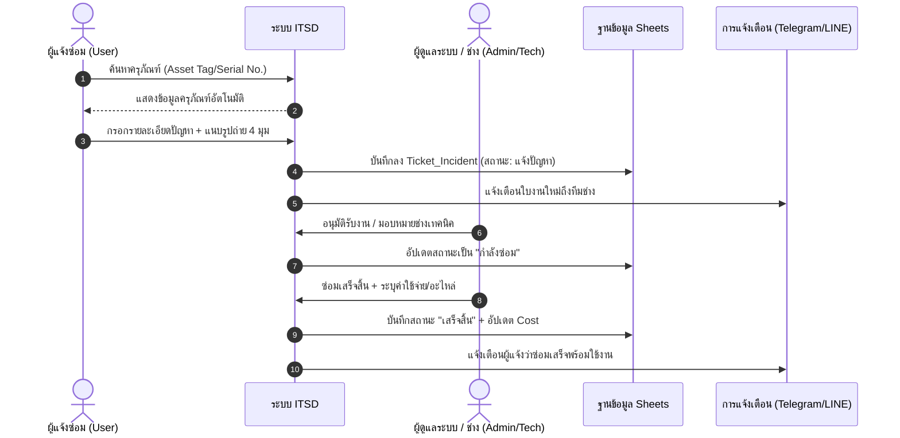

# 🛠️ ITSD : ITServiceDesk (ระบบแจ้งซ่อมออนไลน์ และการจัดการครุภัณฑ์ไอที)

<div align="center">

# ระบบแจ้งซ่อมออนไลน์ และการจัดการครุภัณฑ์ไอที (Enterprise Edition)
### Next-Gen Serverless IT Service Desk, Asset Inventory Management & Automated Workflow Suite

[](https://github.com/longzedesign-dotcom/ITServiceDesk)
[](https://github.com/longzedesign-dotcom/ITServiceDesk)
[](https://github.com/longzedesign-dotcom)
[](https://script.google.com/)
[-0F9D58?style=flat-square&logo=googlesheets)](https://www.google.com/sheets/about/)
[](LICENSE)

**🌐 URL ใช้งานระบบจริง (Web App Production URL):**  
[https://script.google.com/macros/s/AKfycbzHCJ0a_Xh0ItiHzcXIXDPwl5aUqKYCnvI48FTKu3iyWI0UKYtIRWBpdx3RXkw_l6jt/exec](https://script.google.com/macros/s/AKfycbzHCJ0a_Xh0ItiHzcXIXDPwl5aUqKYCnvI48FTKu3iyWI0UKYtIRWBpdx3RXkw_l6jt/exec)

</div>

---

## 📖 สารบัญ
1. [ภาพรวมของระบบ (Overview)](#-ภาพรวมของระบบ-overview)
2. [ผังการทำงานของระบบ (Workflows & Architecture)](#-ผังการทำงานของระบบ-workflows--architecture)
3. [ฟังก์ชันการทำงานหลัก (Key Features)](#-ฟังก์ชันการทำงานหลัก-key-features)
4. [โครงสร้างฐานข้อมูล Google Sheets (DBS_ITSD - 11 ตาราง)](#️-โครงสร้างฐานข้อมูล-google-sheets-dbs_itsd---11-ตาราง)
5. [โครงสร้างไฟล์โค้ดของระบบ (Codebase Architecture)](#-โครงสร้างไฟล์โค้ดของระบบ-codebase-architecture)
6. [บัญชีผู้ใช้เริ่มต้นสำหรับการทดสอบ (Default Accounts)](#-บัญชีผู้ใช้เริ่มต้นสำหรับการทดสอบ-default-accounts)
7. [คู่มือเอกสารอ้างอิงเพิ่มเติม](#-คู่มือเอกสารอ้างอิงเพิ่มเติม)

---

## 🌟 ภาพรวมของระบบ (Overview)

**ITSD : ITServiceDesk (ระบบแจ้งซ่อมออนไลน์ และการจัดการครุภัณฑ์ไอที)** พัฒนาขึ้นด้วยสถาปัตยกรรม **100% Serverless** บน Google Workspace โดยใช้ Google Apps Script (GAS) ขับเคลื่อน Frontend Web App และเชื่อมต่อกับ Google Sheets (`DBS_ITSD`) เป็นฐานข้อมูลหลัก พร้อมใช้ Google Drive ในการจัดเก็บรูปภาพและเอกสารแนบ ช่วยประหยัดค่าใช้จ่ายด้านเซิร์ฟเวอร์ และมีความปลอดภัยระดับองค์กร

ระบบออกแบบมาเพื่อรองรับหน่วยงานที่มีครุภัณฑ์และอุปกรณ์ไอทีกว่า 4,200+ รายการ พร้อมระบบค้นหาอัจฉริยะ การเปิดใบงานแจ้งซ่อม การกระจายงานให้ช่างเทคนิค การติดตามสถานะแบบ Real-time และการสรุปรายงานค่าใช้จ่ายและสถิติงานซ่อมแบบครบวงจร

---

## 🔄 ผังการทำงานของระบบ (Workflows & Architecture)

### 1. สถาปัตยกรรมระบบ (System Architecture)


### 2. วงจรชีวิตใบงานแจ้งซ่อม (Incident Lifecycle Flow)



---

## 🚀 ฟังก์ชันการทำงานหลัก (Key Features)

### 1. หน้าจอหลักและแดชบอร์ดสถิติ (Smart KPI Dashboard)
- **สถิติภาพรวม Real-time**: การ์ดแสดงจำนวนรายการแจ้งซ่อมทั้งหมด, รอดำเนินการ, กำลังซ่อม, ซ่อมเสร็จ, และค่าใช้จ่ายสะสม
- **กราฟสรุปเชิงลึก**: สถิติงานซ่อมแยกตามหมวดหมู่อุปกรณ์ และแนวโน้มค่าใช้จ่ายรายเดือน
- **Top 5 Repeated Repairs**: วิเคราะห์อุปกรณ์ที่มีประวัติส่งซ่อมซ้ำบ่อยที่สุด เพื่อวางแผนจัดซื้อทดแทน

### 2. ระบบเปิดใบงานแจ้งซ่อม (Create Incident Ticket)
- **Auto-Fill Data**: ค้นหาด้วยรหัสครุภัณฑ์ (Asset Tag) หรือหมายเลขซีเรียล (Serial Number) เพื่อดึงยี่ห้อ รุ่น และสถานที่ใช้งานมาแสดงอัตโนมัติ
- **Photo Upload**: ถ่ายภาพหรือแนบรูปภาพความเสียหายได้สูงสุด 4 รูป บันทึกลง Google Drive พร้อมลิงก์เปิดดูทันที
- **ระดับความเร่งด่วน**: เลือกความเร่งด่วน (ต่ำ, ปานกลาง, สูง) พร้อมระบบคำนวณวันเกินกำหนด (Overdue SLA)

### 3. ระบบติดตามและบริหารใบงาน (Ticket Tracking & Assignment)
- **Filter & Search**: กรองตามสถานะงาน (แจ้งปัญหา, กำลังซ่อม, รออะไหล่, เสร็จสิ้น, ยกเลิก) หรือค้นหาตามชื่อผู้แจ้งและเลขที่ใบงาน
- **Technician Assignment**: ผู้ดูแลระบบสามารถมอบหมายช่างผู้รับผิดชอบงานได้ทันที
- **Work Notes**: บันทึกขั้นตอนการแก้ไขปัญหาและสาเหตุเพื่อเก็บเป็น Knowledge Base

### 4. ทะเบียนครุภัณฑ์และสเปกอุปกรณ์ (Asset & Spec Inventory 4,200+ รายการ)
- **ฐานข้อมูลขนาดใหญ่**: รองรับครุภัณฑ์คอมพิวเตอร์และอุปกรณ์ไอทีกว่า 4,278 รายการ
- **ค้นหาละเอียด**: ค้นหาตามประเภท (PC, Notebook, Printer, Network), สำนัก/กอง, ประจำตัวผู้ถือครอง, และสถานะประกัน
- **Technical Spec**: ตรวจสอบรายละเอียดสเปกของเครื่อง (CPU, RAM, Storage, OS, Graphics)
- **Safe Delete**: ลบครุภัณฑ์โดยการย้ายไปไว้ในถังขยะ `Asset_del` ป้องกันข้อมูลสูญหาย

### 5. ระบบการเงินและรายงานค่าใช้จ่าย (Cost & Financial Analysis)
- **บันทึกค่าใช้จ่ายอัตโนมัติ**: เมื่อปิดงานซ่อม ระบบจะลงบัญชีค่าซ่อม/อะไหล่ในตาราง `Cost` ให้ทันที
- **ส่งออกข้อมูล (Export)**: ดาวน์โหลดข้อมูลเป็นไฟล์ Excel, CSV (รองรับ UTF-8 BOM ภาษาไทยไม่เพี้ยน) หรือพิมพ์เป็นเอกสาร PDF

### 6. ความปลอดภัยและการกำหนดสิทธิ์ (Security & RBAC)
- **รหัสผ่านปลอดภัย**: เข้ารหัสด้วย `SHA-256 + Salt` ป้องกันการดู Plaintext รหัสผ่าน
- **Lockout Protection**: ล็อกบัญชีชั่วคราว 30 นาทีอัตโนมัติหากป้อนรหัสผิดติดต่อกันเกิน 5 ครั้ง
- **Session Protection**: เซสชันควบคุมฝั่งเซิร์ฟเวอร์ผ่าน `CacheService` อายุ 6 ชั่วโมง
- **Eye Icon Toggle**: สลับดูรหัสผ่านได้ทั้งหน้า Login และสมัครสมาชิก

---

## 🗄️ โครงสร้างฐานข้อมูล Google Sheets (DBS_ITSD - 11 ตาราง)

| ลำดับ | ชื่อชีต (Sheet Name) | คำอธิบาย | จำนวนคอลัมน์ |
| :---: | :--- | :--- | :---: |
| 1 | **`Users`** | บัญชีผู้ใช้งาน สิทธิ์ รหัสผ่านที่เข้ารหัส และประวัติล็อกอิน | 18 |
| 2 | **`Asset`** | ทะเบียนครุภัณฑ์ อุปกรณ์ไอที และสถานที่ติดตั้ง (4,278 รายการ) | 20 |
| 3 | **`Tecnical_Spec`** | รายละเอียดสเปกทางเทคนิคของอุปกรณ์ (CPU, RAM, Storage) | 17 |
| 4 | **`Ticket_Incident`** | รายการใบงานแจ้งซ่อม และประวัติการดำเนินการ | 20 |
| 5 | **`Master_Reference`** | แคตตาล็อกหมวดหมู่อุปกรณ์ ยี่ห้อ และรุ่นมาตรฐาน | 4 |
| 6 | **`Cost`** | บันทึกค่าใช้จ่ายการซ่อมบำรุงและค่าอะไหล่ | 11 |
| 7 | **`Asset_del`** | ถังขยะสำรองข้อมูลครุภัณฑ์ที่ถูกลบออกจากระบบ | 22 |
| 8 | **`SystemLog`** | บันทึก Audit Log กิจกรรมการเข้าใช้งานและการเปลี่ยนแปลงข้อมูล | 6 |
| 9 | **` Setting`** | การตั้งค่าระบบและการแจ้งเตือนอัตโนมัติ | 3 |
| 10 | **`Reference`** | ตารางข้อมูลอ้างอิงรหัสพัสดุและฝ่ายงาน | 31 |
| 11 | **`Data_Dic`** | พจนานุกรมข้อมูล (Data Dictionary) คำอธิบายคอลัมน์ทั้งหมด | 28 |

---

## 📂 โครงสร้างไฟล์โค้ดของระบบ (Codebase Architecture)

```
ITSD/
├── .clasp.json               # การตั้งค่าเชื่อมต่อกับ Google Apps Script Project
├── .gitignore                # จัดการไฟล์ที่ไม่ต้องนำขึ้น Git
├── README.md                 # ภาพรวมและสถาปัตยกรรมระบบ
├── INSTALL_GUIDE.md          # คู่มือการติดตั้งและตั้งค่าระบบ
├── MANUAL_USER.md            # คู่มือการใช้งานระบบสำหรับผู้ใช้ทุกกลุ่ม
└── src/                      # โฟลเดอร์ Source Code ทั้งหมด
    ├── appsscript.json       # Manifest กำหนด Timezone (Asia/Bangkok) และสิทธิ์ Web App
    ├── Config.gs             # กำหนดค่าคงที่ SPREADSHEET_ID, FOLDER_ID, Mapping คอลัมน์
    ├── Main.gs               # Gateway จัดการ doGet, doPost, Session, API Controller
    ├── SecurityService.gs    # บริการความปลอดภัย SHA-256 + Salt และ Account Lockout
    ├── CreateIssue.gs        # ฟังก์ชันเปิดใบแจ้งซ่อมใหม่ และอัปโหลดรูปลง Google Drive
    ├── UpdateIssue.gs        # ฟังก์ชันอัปเดตสถานะงานซ่อม และคำนวณค่าใช้จ่าย
    ├── ApproveIssue.gs       # บริการอนุมัติใบงานแจ้งซ่อม
    ├── Approve.gs            # บริการเข้าสู่ระบบและอนุมัติผู้ใช้งาน
    ├── Register.gs           # บริการลงทะเบียนผู้ใช้งานใหม่
    ├── AssetOperations.gs    # บริการจัดการครุภัณฑ์ (เพิ่ม, แก้ไข, ลบลง Asset_del)
    ├── MasterData.gs         # ฟังก์ชันดึง Master Data, Categories, Technicians, Assets
    ├── ReportIssue.gs        # ฟังก์ชันประมวลผลรายงาน ค่าใช้จ่าย สถิติ และส่งออก CSV
    ├── ConfigIssue.gs        # ระบบตรวจสอบแจ้งซ่อมเกินกำหนด (Overdue) และตั้งค่า Triggers
    ├── Notification.gs       # บริการส่งข้อความแจ้งเตือนผ่าน Telegram Bot API
    ├── Logger.gs             # บริการบันทึก Audit Activity Log
    ├── Backup.gs             # บริการสำรองข้อมูลฐานข้อมูลอัตโนมัติประจำวัน
    ├── Login.html            # หน้าจอเข้าสู่ระบบและสมัครสมาชิก ดีไซน์ Glassmorphic พร้อม Show/Hide Password
    └── Index.html            # หน้าจอ Single Page Application แดชบอร์ดและจัดการงานซ่อมครบวงจร
```

---

## 👥 บัญชีผู้ใช้เริ่มต้นสำหรับการทดสอบ (Default Accounts)

| รหัสผู้ใช้ | Username | ชื่อ-นามสกุล | แผนก/ฝ่าย | สิทธิ์ (Role) | สถานะ |
| :---: | :---: | :--- | :---: | :---: | :---: |
| **U003** | `Chaloem.T` | คุณเฉลิมพร ถาโคตร | ไอที | **Admin** | ใช้งาน |
| **U001** | `Anutin.C` | คุณอนุทิน ชาญวีระยำ | อ้ายทุย | **User** | ใช้งาน |
| **U002** | `Kantasit.C` | คุณคันธสิทธิ์ ช่องดารากุล | ไอที | **User** | ใช้งาน |

> [!NOTE]  
> หากต้องการรีเซ็ตรหัสผ่านหรือทดสอบระบบ ผู้ดูแลระบบสามารถใช้รหัสผ่าน Hash ที่กำหนดไว้ในตาราง `Users` หรือลงทะเบียนผู้ใช้ใหม่ผ่านหน้าจอและให้อนุมัติผ่าน Admin ได้ทันที

---

## 📚 คู่มือเอกสารอ้างอิงเพิ่มเติม

- **คู่มือการติดตั้งระบบฉบับละเอียด**: ดูได้ที่ [`INSTALL_GUIDE.md`](./INSTALL_GUIDE.md)
- **คู่มือการใช้งานระบบสำหรับผู้ใช้และช่าง**: ดูได้ที่ [`MANUAL_USER.md`](./MANUAL_USER.md)
- **ที่เก็บโค้ดบน GitHub**: [https://github.com/longzedesign-dotcom/ITServiceDesk](https://github.com/longzedesign-dotcom/ITServiceDesk)

---

<div align="center">
  <sub>พัฒนาและดูแลโดยทีมพัฒนาระบบสารสนเทศ © 2026 ITSD : ITServiceDesk. All rights reserved.</sub>
</div>
