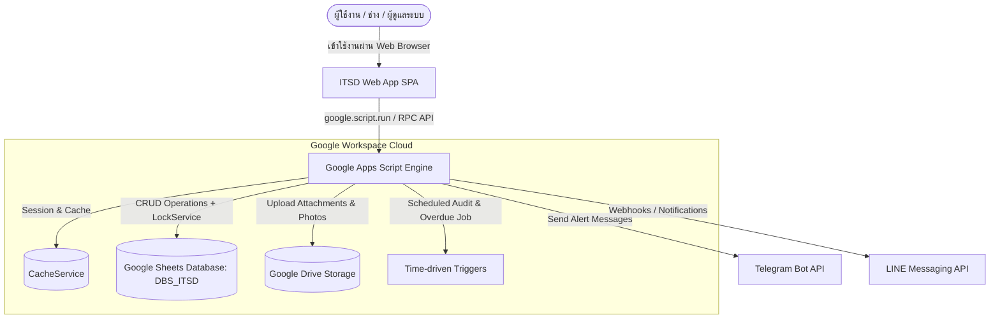
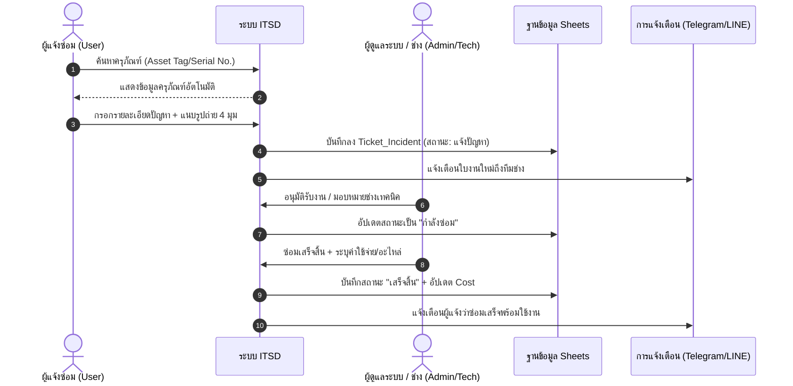

# 🛠️ ITSD : ITServiceDesk (ระบบแจ้งซ่อมออนไลน์ และการจัดการครุภัณฑ์ไอที)

<div align="center">

# ระบบแจ้งซ่อมออนไลน์ และการจัดการครุภัณฑ์ไอที (Enterprise Edition)
### Next-Gen Serverless IT Service Desk, Asset Inventory Management & Automated Workflow Suite

[](https://github.com/longzedesign-dotcom/ITServiceDesk)
[-ff6b2b?style=flat-square)](https://github.com/longzedesign-dotcom/ITServiceDesk)
[](https://github.com/longzedesign-dotcom)
[](https://script.google.com/)
[-0F9D58?style=flat-square&logo=googlesheets)](https://www.google.com/sheets/about/)
[](LICENSE)

**🌐 URL ใช้งานระบบจริง (Web App Production URL):**  
[https://script.google.com/macros/s/AKfycbxTiZ-1A7NiE8jFhNjf_pDE0GQSmWn539J7RtfJ2M3EsuVkS8DkhfLcXNhw9FMijYf3/exec](https://script.google.com/macros/s/AKfycbxTiZ-1A7NiE8jFhNjf_pDE0GQSmWn539J7RtfJ2M3EsuVkS8DkhfLcXNhw9FMijYf3/exec)

</div>

---

## 📖 สารบัญ
1. [ภาพรวมของระบบ (Overview)](#-ภาพรวมของระบบ-overview)
2. [ผังการทำงานของระบบ (Workflows & Architecture)](#-ผังการทำงานของระบบ-workflows--architecture)
3. [ฟังก์ชันการทำงานหลัก (Key Features)](#-ฟังก์ชันการทำงานหลัก-key-features)
4. [โครงสร้างฐานข้อมูล Google Sheets (DBS_ITSD - 26 ตารางมาตรฐาน)](#️-โครงสร้างฐานข้อมูล-google-sheets-dbs_itsd---26-ตารางมาตรฐาน)
5. [โครงสร้างไฟล์โค้ดของระบบ (Codebase Architecture)](#-โครงสร้างไฟล์โค้ดของระบบ-codebase-architecture)
6. [บัญชีผู้ใช้เริ่มต้นสำหรับการทดสอบ (Default Accounts)](#-บัญชีผู้ใช้เริ่มต้นสำหรับการทดสอบ-default-accounts)
7. [คู่มือเอกสารอ้างอิงเพิ่มเติม](#-คู่มือเอกสารอ้างอิงเพิ่มเติม)

---

## 🌟 ภาพรวมของระบบ (Overview)

**ITSD : ITServiceDesk (ระบบแจ้งซ่อมออนไลน์ และการจัดการครุภัณฑ์ไอที)** พัฒนาขึ้นด้วยสถาปัตยกรรม **100% Serverless** บน Google Workspace โดยใช้ Google Apps Script (GAS) ขับเคลื่อน Frontend Web App และเชื่อมต่อกับ Google Sheets (`DBS_ITSD`) เป็นฐานข้อมูลหลัก พร้อมใช้ Google Drive ในการจัดเก็บรูปภาพและเอกสารแนบ ช่วยประหยัดค่าใช้จ่ายด้านเซิร์ฟเวอร์ และมีความปลอดภัยระดับองค์กร

ระบบออกแบบมาเพื่อรองรับหน่วยงานที่มีครุภัณฑ์และอุปกรณ์ไอทีกว่า 4,200+ รายการ พร้อมระบบค้นหาอัจฉริยะ การเปิดใบงานแจ้งซ่อม การกระจายงานให้ช่างเทคนิค การติดตามสถานะแบบ Real-time และการสรุปรายงานค่าใช้จ่ายและสถิติงานซ่อมแบบครบวงจร

---

## 🔄 ผังการทำงานของระบบ (Workflows & Architecture)

### 1. สถาปัตยกรรมระบบ (System Architecture)



### 2. วงจรชีวิตใบงานแจ้งซ่อม (Incident Lifecycle Flow)



---

## 🚀 ฟังก์ชันการทำงานหลัก (Key Features)

### 1. หน้าจอหลักและแดชบอร์ดสถิติ (Smart KPI Dashboard)
- **สถิติภาพรวม Real-time**: การ์ดแสดงจำนวนรายการแจ้งซ่อมทั้งหมด, รอดำเนินการ, กำลังซ่อม, ซ่อมเสร็จ, และค่าใช้จ่ายสะสม
- **กราฟสรุปเชิงลึก**: สถิติงานซ่อมแยกตามหมวดหมู่อุปกรณ์ และแนวโน้มค่าใช้จ่ายรายเดือน
- **Top 5 Repeated Repairs**: วิเคราะห์อุปกรณ์ที่มีประวัติส่งซ่อมซ้ำบ่อยที่สุด เพื่อวางแผนจัดซื้อทดแทน

### 2. ระบบเปิดใบงานแจ้งซ่อม (Create Incident Ticket)
- **Auto-Fill Data**: ค้นหาด้วยรหัสครุภัณฑ์ (Asset Tag) หรือหมายเลขซีเรียล (Serial Number) เพื่อดึงยี่ห้อ รุ่น และสถานที่ใช้งานมาแสดงอัตโนมัติ
- **Photo Upload**: ถ่ายภาพหรือแนบรูปภาพความเสียหายได้สูงสุด 4 รูป บันทึกลง Google Drive พร้อมลิงก์เปิดดูทันที
- **ระดับความเร่งด่วน**: เลือกความเร่งด่วน (ต่ำ, ปานกลาง, สูง) พร้อมระบบคำนวณวันเกินกำหนด (Overdue SLA)

### 3. ระบบติดตามและบริหารใบงาน (Ticket Tracking & Assignment)
- **Filter & Search**: กรองตามสถานะงาน (แจ้งปัญหา, กำลังซ่อม, รออะไหล่, เสร็จสิ้น, ยกเลิก) หรือค้นหาตามชื่อผู้แจ้งและเลขที่ใบงาน
- **Technician Assignment**: ผู้ดูแลระบบสามารถมอบหมายช่างผู้รับผิดชอบงานได้ทันที
- **Work Notes**: บันทึกขั้นตอนการแก้ไขปัญหาและสาเหตุเพื่อเก็บเป็น Knowledge Base

### 4. ทะเบียนครุภัณฑ์และสเปกอุปกรณ์ (Asset & Spec Inventory 4,200+ รายการ)
- **ฐานข้อมูลขนาดใหญ่**: รองรับครุภัณฑ์คอมพิวเตอร์และอุปกรณ์ไอทีกว่า 4,278 รายการ
- **ค้นหาละเอียด**: ค้นหาตามประเภท (PC, Notebook, Printer, Network), สำนัก/กอง, ประจำตัวผู้ถือครอง, และสถานะประกัน
- **Technical Spec**: ตรวจสอบรายละเอียดสเปกของเครื่อง (CPU, RAM, Storage, OS, Graphics)
- **Safe Delete**: ลบครุภัณฑ์โดยการย้ายไปไว้ในถังขยะ `Asset_del` ป้องกันข้อมูลสูญหาย

### 5. ระบบการเงินและรายงานค่าใช้จ่าย (Cost & Financial Analysis)
- **บันทึกค่าใช้จ่ายอัตโนมัติ**: เมื่อปิดงานซ่อม ระบบจะลงบัญชีค่าซ่อม/อะไหล่ในตาราง `Cost` ให้ทันที
- **ส่งออกข้อมูล (Export)**: ดาวน์โหลดข้อมูลเป็นไฟล์ Excel, CSV (รองรับ UTF-8 BOM ภาษาไทยไม่เพี้ยน) หรือพิมพ์เป็นเอกสาร PDF

### 6. ความปลอดภัยและการกำหนดสิทธิ์ (Security & RBAC)
- **รหัสผ่านปลอดภัย**: เข้ารหัสด้วย `SHA-256 + Salt` ป้องกันการดู Plaintext รหัสผ่าน
- **Lockout Protection**: ล็อกบัญชีชั่วคราว 30 นาทีอัตโนมัติหากป้อนรหัสผิดติดต่อกันเกิน 5 ครั้ง
- **Session Protection**: เซสชันควบคุมฝั่งเซิร์ฟเวอร์ผ่าน `CacheService` อายุ 6 ชั่วโมง
- **Eye Icon Toggle**: สลับดูรหัสผ่านได้ทั้งหน้า Login และสมัครสมาชิก

---

## 🗄️ โครงสร้างฐานข้อมูล Google Sheets (DBS_ITSD - 26 ตารางมาตรฐาน)

ฐานข้อมูลหลักของระบบจัดเก็บไว้ที่ Google Sheets:  
**ID: `1JtOd13gEJpwqPlaBJy87hGrUa1hO_MnVmmKRAaoAyEs` (DBS_ITSD)**

| ลำดับ | ชื่อชีต (Sheet Name) | คำอธิบายการจัดเก็บข้อมูล |
| :---: | :--- | :--- |
| 1 | **`APP_USERS`** | บัญชีผู้ใช้งานระบบ, Salt, Hash รหัสผ่าน (12,000 rounds), สถานะล็อกอิน และสิทธิ์ |
| 2 | **`APP_USER_PROFILE`** | ข้อมูลส่วนบุคคล เบอร์โทรศัพท์ แผนก และตำแหน่งงาน |
| 3 | **`APP_ROLES`** | นิยามบทบาทผู้ใช้งาน (ADMIN, MANAGER, TECHNICIAN, ITSUPPORT, USER) |
| 4 | **`APP_ROLE_PERMISSIONS`** | สิทธิ์การเข้าถึงเมนูและโมดูลระบบ |
| 5 | **`APP_ROLE_ACTION_PERMISSIONS`** | สิทธิ์การกระทำเชิงลึก (Action Matrix) ของแต่ละบทบาท |
| 6 | **`APP_SESSIONS`** | เซสชันโทเคนและอายุการเข้าสู่ระบบของผู้ใช้งาน |
| 7 | **`APP_AUDIT_LOG`** | บันทึกประวัติการกระทำและ Audit Trail ความปลอดภัยของระบบ |
| 8 | **`APP_SETTINGS`** | การตั้งค่าระบบ ชื่อโครงการ โฟลเดอร์ Drive และไอคอนระบบ |
| 9 | **`APP_LOOKUPS`** | ค่าตัวเลือกมาตรฐาน (ประเภทปัญหา, หมวดหมู่อุปกรณ์, สถานะ) |
| 10 | **`Branding`** | ข้อมูลภาพลักษณ์องค์กร โลโก้ และชุดสีของระบบ |
| 11 | **`INVENTORY`** | ทะเบียนครุภัณฑ์และอุปกรณ์คอมพิวเตอร์ทั้งหมด |
| 12 | **`INVENTORY_SORTED`** | ทะเบียนครุภัณฑ์ฉบับจัดเรียงดัชนีเพื่อการค้นหารวดเร็ว |
| 13 | **`MST_DEVICE_MODELS`** | แคตตาล็อกประเภท ยี่ห้อ และรุ่นอุปกรณ์มาตรฐาน |
| 14 | **`SOFTWARE_LICENSES`** | ทะเบียนใบอนุญาตซอฟต์แวร์และคีย์ลิขสิทธิ์ |
| 15 | **`MST_ORG_UNITS`** | โครงสร้างฝ่าย สำนัก และกลุ่มงานในองค์กร |
| 16 | **`INCIDENT`** | รายการใบงานแจ้งซ่อมหลักทั้งหมด (Tickets) |
| 17 | **`INCIDENT_META`** | ข้อมูลประกอบและข้อมูลจำเพาะทางเทคนิคของใบงาน |
| 18 | **`INCIDENT_EVENTS`** | ประวัติ Timeline เหตุการณ์และขั้นตอนการดำเนินงานซ่อม |
| 19 | **`INCIDENT_FILES`** | รายการไฟล์แนบ รูปถ่ายความเสียหาย และเอกสาร Service |
| 20 | **`TICKET_SERVICE_REPORT`** | ข้อมูลรายงานสรุปงานซ่อมและใบส่งคืนอุปกรณ์ |
| 21 | **`PM_PLANNINGS`** | แผนแม่บทโครงการบำรุงรักษาเชิงป้องกัน (PM) |
| 22 | **`PM_PLANNING_ITEMS`** | รายการอุปกรณ์และพื้นที่ในแผนการตรวจเช็ก PM |
| 23 | **`PM_PLANS`** | ตารางการนัดหมายและการเข้าตรวจเช็กตามปฏิทิน |
| 24 | **`PM_PLAN_HISTORY`** | ประวัติและบันทึกผลการบำรุงรักษาเชิงป้องกัน |
| 25 | **`LINE_INBOX`** | ข้อความและรูปภาพที่ส่งเข้ามาจาก LINE Official Account |
| 26 | **`LINE_INBOX_REVIEWS`** | รายการตรวจสอบและแปลงข้อความ LINE เป็น Ticket |

---

## 📂 โครงสร้างไฟล์โค้ดของระบบ (Codebase Architecture)

```
ITSD/
├── .clasp.json               # การตั้งค่าเชื่อมต่อกับ Google Apps Script Project
├── .gitignore                # จัดการไฟล์ที่ไม่ต้องนำขึ้น Git
├── README.md                 # ภาพรวมและสถาปัตยกรรมระบบ
├── INSTALL_GUIDE.md          # คู่มือการติดตั้งและตั้งค่าระบบ
├── MANUAL_USER.md            # คู่มือการใช้งานระบบสำหรับผู้ใช้ทุกกลุ่ม
├── PATCH_NOTES.md            # ประวัติการ Patch Update และ Release Notes
├── COLOR_TEMPLATE.md         # สเปกแม่แบบสี UI 6-Color Standard
├── DBS_ITSD.xlsx             # สำเนาโครงสร้างและข้อมูลฐานข้อมูล 26 ตารางมาตรฐาน
└── src/                      # โฟลเดอร์ Source Code สำหรับ Deploy ขึ้น Google Apps Script
    ├── appsscript.json       # Manifest กำหนด Timezone (Asia/Bangkok), V8 Runtime และ OAuth Scopes
    ├── Entrypoints.js        # Entrypoint หลัก doGet() ให้บริการ Web App และ doPost() รับ LINE Webhook
    ├── Api.js                # Public API Facade เชื่อมต่อระหว่าง Frontend SPA กับ Backend Engine
    ├── Server.js             # Core Enterprise Engine (Auth, RBAC, Inventory, Incident, PM, LINE)
    ├── Index.html            # โครงสร้าง Web Application Shell, ฟอร์ม Login และ Layout
    ├── UI_Client.html        # Client Controller ควบคุม State, Routing, Form และ Event Handlers
    ├── UI_Styles.html        # Complete Design System, Responsive Themes (12 Palettes & Dark Mode)
    └── UI_Templates.html     # Client-side Template Partials สำหรับ Dynamic Views
```

---

## 👥 บัญชีผู้ใช้เริ่มต้นสำหรับการทดสอบ (Default Accounts)

ข้อมูลบัญชีผู้ใช้งานในตาราง `APP_USERS` ที่ผ่านการเข้ารหัส SHA-256 with Salt 12,000 รอบ พร้อมเข้าใช้งานได้ทันที:

| รหัสผู้ใช้ | Username | ชื่อ-นามสกุล | สิทธิ์ (Role) | รหัสผ่านเริ่มต้น | สถานะ |
| :---: | :---: | :--- | :---: | :---: | :---: |
| **USR-ADMIN** | `ADMIN` | ผู้ดูแลระบบส่วนกลาง | **ADMIN** | `Admin@ITSD2026!` | พร้อมใช้งาน |
| **USR-CHALOEM** | `CHALOEM` | คุณเฉลิม ธนากิจโภคิน | **ADMIN** | `Admin@ITSD2026!` | พร้อมใช้งาน |
| **USR-MANAGER** | `MANAGER` | ผู้จัดการ | **MANAGER** | `Admin@ITSD2026!` | พร้อมใช้งาน |
| **USR-TECHNICIAN** | `TECHNICIAN` | เจ้าหน้าที่ IT | **TECHNICIAN** | `Admin@ITSD2026!` | พร้อมใช้งาน |
| **USR-ITSUPPORT** | `ITSUPPORT` | ทศพล กาญจนพันธ์ | **ITSUPPORT** | `Admin@ITSD2026!` | พร้อมใช้งาน |

> [!NOTE]  
> ผู้ใช้งานสามารถเปลี่ยนรหัสผ่านส่วนตัวได้ที่เมนูโปรไฟล์หลังจากเข้าสู่ระบบสำเร็จ ระบบปฏิบัติตามมาตรฐานความปลอดภัย NIST SP 800-63B และระงับบัญชีชั่วคราวอัตโนมัติหากกรอกรหัสผ่านผิดเกิน 5 ครั้ง

---

## 📚 คู่มือเอกสารอ้างอิงเพิ่มเติม

- **คู่มือการติดตั้งระบบฉบับละเอียด**: ดูได้ที่ [`INSTALL_GUIDE.md`](./INSTALL_GUIDE.md)
- **คู่มือการใช้งานระบบสำหรับผู้ใช้และช่าง**: ดูได้ที่ [`MANUAL_USER.md`](./MANUAL_USER.md)
- **ที่เก็บโค้ดบน GitHub**: [https://github.com/longzedesign-dotcom/ITServiceDesk](https://github.com/longzedesign-dotcom/ITServiceDesk)

---

<div align="center">
  <sub>พัฒนาและดูแลโดยทีมพัฒนาระบบสารสนเทศ © 2026 ITSD : ITServiceDesk. All rights reserved.</sub>
</div>
